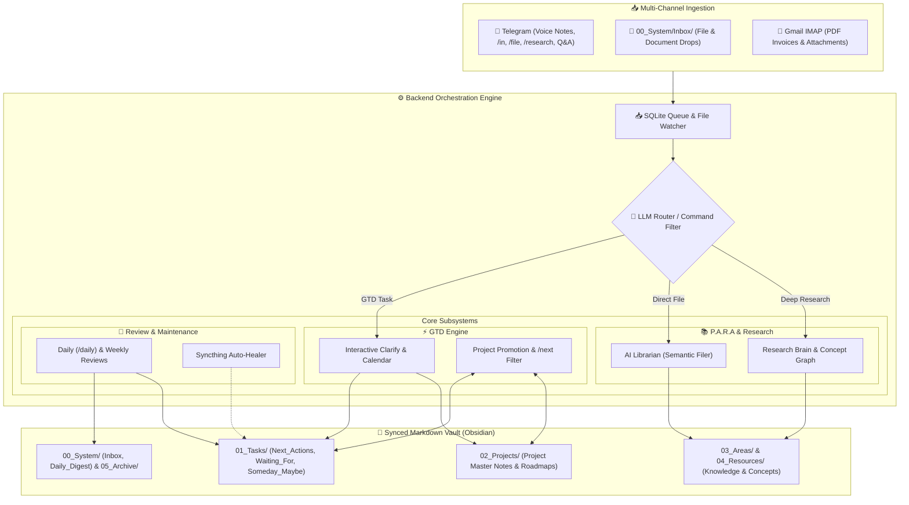

# 🧠 Second Brain (GTD + P.A.R.A Fusion)

> **An Agentic Personal Knowledge & Task Operating System for Obsidian.**  
> Powered by Local CUDA Faster-Whisper, SQLite-VSS Vector Search, and Google Gemini.

[](https://python.org)
[](https://fastapi.tiangolo.com)
[](https://obsidian.md)
[](https://ai.google.dev)
[](LICENSE)

---

## 📑 Table of Contents

- [Overview & Philosophy](#-overview--philosophy)
- [Key Capabilities](#-key-capabilities)
- [Telegram Command Reference](#-telegram-command-reference)
- [Vault Hierarchy (GTD + P.A.R.A)](#-vault-hierarchy-gtd--para)
- [System Architecture](#-system-architecture)
- [Installation & Setup](#-installation--setup)
- [Configuration Reference](#-configuration-reference)
- [Documentation Index](#-documentation-index)
- [License](#-license)

---

## 💡 Overview & Philosophy

The **Second Brain** operates on the **"Agent-as-Librarian"** paradigm: an intelligent background daemon running 24/7 on your personal machine that actively triages, organizes, links, and surfaces information over a passive, 100% private Markdown vault.

### Why Second Brain?
* **Absolute Data Ownership:** No proprietary cloud databases or walled gardens. Your tasks, project roadmaps, and knowledge graphs exist as standard Markdown files and local SQLite databases.
* **GTD + P.A.R.A Fusion:** Unifies David Allen's **Getting Things Done (GTD)** actionable workflows (`Next_Actions`, `Waiting_For`, `Someday_Maybe`) with Tiago Forte's **P.A.R.A** organizational structure (`Projects`, `Areas`, `Resources`, `Archive`).
* **Zero-Friction Voice & Text Capture:** Dictate thoughts while driving or walking. Local GPU Whisper transcribes and queues them for structured triage.
* **Proactive Project Momentum:** Completing an action in Telegram or Obsidian automatically triggers the system to prompt and promote the next step from your project roadmap.
* **Zero-to-Low Cost:** Designed to run entirely on local compute and Google Gemini / Cloud free tiers.

---

## ✨ Key Capabilities

### 1. 📥 Frictionless Multi-Channel Capture
* **Voice Notes (Telegram):** Send raw voice notes to your Telegram bot. Transcribed locally via `faster-whisper` on CUDA GPU with multi-topic splitting.
* **Quick Text (Telegram):** Capture quick thoughts via `/in <text>` in Telegram.
* **Direct Filing (Telegram):** Send `/file <URL/doc>` to bypass GTD triage and file documents straight into P.A.R.A reference folders.
* **Drop Folder:** Drop PDFs, notes, or audio files into `00_System/Inbox/` for automatic ingestion.
* **Gmail IMAP Poller:** Auto-polls your email for flagged receipts, invoices, and PDF attachments, extracting content and filing it directly to your vault.

### 2. ⚡ Interactive Clarification Engine (`/clarify`)
* Triages captured items in manageable 5-item batches using an 8-option decision tree:
  `[Next Action]` `[Project Roadmap]` `[New Project]` `[Waiting For]` `[Someday/Maybe]` `[AI Librarian]` `[2-Min Rule]` `[Trash]`.
* **1-Tap AI Smart Defaults:** High-confidence recommendations automatically pre-tag context and project links.
* **Inline Calendar Picker:** Natural date deferrals (`🔔 YYYY-MM-DD`) and ticklers using a dynamic visual keyboard calendar.

### 3. 🎯 Dynamic Project Master Notes & Step Auto-Promotion
* Projects in `02_Projects/` maintain a structured **Desired Outcome**, **`## Project Steps`** future roadmap backlog, and dynamic **Dataview** active task views.
* **Automated Step Promotion:** Whenever a project action is completed via **Telegram `/done`** or checked off **`- [x]` in Obsidian**:
  1. The bot inspects the project roadmap.
  2. Pings Telegram with candidate steps: `[1. Step A]` `[2. Step B]`.
  3. Prompts for context (`@home`, `@computer`, `@errands`, `@phone`, `@anywhere`, `@office`).
  4. Appends the promoted action to `Next_Actions.md` and deletes it from `## Project Steps`.

### 4. 🌅 Action-Oriented Daily & Weekly Reviews
* **Daily Review (`/daily` & 07:30 Morning Briefing):**
  - 🚨 Upcoming deadlines (projects with `due_date` <= 14 days).
  - 🔔 Surfaced ticklers unlocking today.
  - ⚡ Active Next Actions grouped by context (`@home`, `@computer`, `@errands`, etc.).
  - ⏳ Active delegated `Waiting For` items.
* **Weekly Review (`/reflect` & Friday Briefing):**
  - Audits orphaned projects (0 active next actions), stale waitings (>5 days), and Someday/Maybe ideas.
  - Synthesizes newly learned research concepts from the past 7 days.
* **Holiday Pause Mode (`/holiday`):** Pauses daily/weekly briefings by scope (`Personal`, `Professional`, `All`) with calendar date return selection.

### 5. 📚 Deep Research Knowledge Graph (`/research`)
* Ingests web articles, YouTube transcripts, PDFs, and slide decks (`.pptx`).
* Uses Gemini with **Context Caching** to extract dense summaries and 5–15 atomic concept nodes bidirectionally linked in `04_Resources/Research_Brain/Concepts/`.

### 6. 💬 Conversational Vault Q&A (RAG)
* Ask plain-text natural language questions in Telegram without command prefixes.
* Retrieves relevant context using `sqlite-vss` vector search with a 5-turn conversational context memory window.

### 7. 🛡️ Syncthing Auto-Healer
* Monitors for multi-device Syncthing sync conflicts (`*.sync-conflict-*.md`).
* Automatically performs line-level merging (preserving `- [x]` completion states) and creates atomic Git commits.

---

## 🤖 Telegram Command Reference

| Command | Description |
| :--- | :--- |
| *(plain text)* | **Conversational Q&A** — Natural language queries against your vault with 5-turn context memory. |
| *(voice note)* | **Audio Capture** — Transcribes via local Whisper and saves to `01_Tasks/Captured.md`. |
| `/in <text>` | **GTD Capture** — Append a raw capture directly to `01_Tasks/Captured.md`. |
| `/file <URL/doc>` | **Direct PARA Filing** — Routes directly to AI Librarian, bypassing GTD clarify triage. |
| `/research <URL>` | **Deep Research** — Ingests content into Research Brain with full knowledge graph concept extraction. |
| `/clarify` | **Interactive Triage** — Process captured items in 5-item batches with inline buttons & calendar picker. |
| `/next [@context]` | **Context Execution** — Filter tasks (`@home`, `@computer`, `@errands`, `@phone`, `@anywhere`, `@office`, `@WFH`). |
| `/waiting` | **Delegated Tracking** — View pending items owed by others with age and follow-up dates. |
| `/project <name>` | **Project Dashboard** — View Desired Outcome, Active Actions, Roadmap Steps, and References. |
| `/project <name> add <step>` | **Roadmap Backlog** — Append a new future step to `## Project Steps` in a project note. |
| `/archive <name>` | **Archive Project** — Marks project completed and moves it to `05_Archive/`. |
| `/done <item>` | **Complete Action** — Archives task to `01_Tasks/Completed.md` and triggers 1-tap step promotion. |
| `/tickle <item>` | **Defer Task** — Opens visual calendar picker to set a `🔔 YYYY-MM-DD` tickler date. |
| `/daily` | **Daily Review** — On-demand action review (deadlines <=14d, surfaced ticklers, next actions by context). |
| `/weekly` / `/status` | **System Sitrep** — High-level counts across all GTD task lists, active projects, and 7-day completed actions. |
| `/reflect` | **Guided Review** — Step-by-step interactive weekly reflection (inbox zero, stale waitings, orphaned projects, Someday/Maybe). |
| `/holiday` | **Pause Reviews** — Pause automated briefings by scope (`Personal`, `Professional`, `All`) with calendar picker. |
| `/jira <summary>` | **Jira Export** — Create a ticket directly in Jira backlog. |
| `/undo` | **Safety Revert** — Reverts the last automated Git commit (`git revert HEAD`). |
| `/help` | **Help Menu** — Full command reference and workflow examples. |

---

## 📂 Vault Hierarchy (GTD + P.A.R.A)

```text
vault/
├── 00_System/
│   ├── Inbox/                     <-- CAPTURE STAGING (raw items & drops)
│   │   └── Archive/               <-- Clarified source files kept for traceability
│   ├── Internal/
│   │   └── Digests/               <-- Rolling archive of daily digests (14-day retention)
│   ├── Daily_Digest.md            <-- Latest daily review briefing
│   ├── _INDEX.md                  <-- Auto-generated vault sitemap
│   └── Librarian_Activity.md      <-- Ingestion and filing audit log
├── 01_Tasks/                      <-- GTD ACTION HUB
│   ├── Next_Actions.md            <-- ⚡ Context-tagged actions (@home, @computer, etc.)
│   ├── Waiting_For.md             <-- ⏳ Delegated actions (#waiting(Name))
│   ├── Someday_Maybe.md           <-- 💡 Future ideas & uncommitted desires
│   ├── Captured.md                <-- 📥 Raw captures awaiting /clarify
│   └── Completed.md               <-- ✅ Archived completed actions
├── 02_Projects/                   <-- ACTIVE PROJECTS
│   ├── Personal/                  <-- Personal projects & deliverables
│   └── Professional/              <-- Work & career deliverables
├── 03_Areas/                      <-- ONGOING RESPONSIBILITIES (Family, Health, Coding)
├── 04_Resources/                  <-- REFERENCE & RESEARCH BRAIN
│   └── Research_Brain/
│       ├── Concepts/              <-- Atomic concept pages with bidirectional links
│       ├── Sources/               <-- Raw source transcripts and ingested files
│       └── Summaries/             <-- Structured AI summary nodes
└── 05_Archive/                    <-- COMPLETED DELIVERABLES & HISTORICAL ARCHIVE
```

---

## 🏛️ System Architecture



---

## 🚀 Installation & Setup

### 1. Prerequisites
- **OS:** Linux (e.g. Fedora Server / Ubuntu), macOS, or WSL2.
- **Python:** Python 3.11+
- **Package Manager:** [`uv`](https://github.com/astral-sh/uv) (recommended) or standard Python `venv`.
- **Obsidian:** Installed locally on desktop or mobile.
- **Telegram Bot:** Create a bot via [@BotFather](https://t.me/BotFather) on Telegram and obtain your API Token.
- **Google AI Studio Key:** Obtain a free API Key from [aistudio.google.com](https://aistudio.google.com).
- *(Optional GPU):* NVIDIA GPU with CUDA drivers for accelerated local Whisper audio transcription.

---

### 2. Clone & Install Backend

```bash
# 1. Clone repository
git clone https://github.com/sdmeers/centaur_brain.git second_brain
cd second_brain/backend

# 2. Create virtual environment and install dependencies using uv
uv venv
uv sync

# 3. Create environment configuration
cp .env.example .env
```

---

### 3. Configure Environment (`backend/.env`)

Edit `backend/.env` with your personal paths and keys:

```ini
# Vault Path
OBSIDIAN_VAULT_PATH=/home/username/vault
PORT=8080

# LLM & Embedding Settings
LLM_PROVIDER=gemini
LLM_MODEL=gemini-3.1-flash-lite
EMBEDDING_PROVIDER=gemini
EMBEDDING_MODEL=gemini-embedding-2
GEMINI_API_KEY=AIzaSy...

# Telegram Bot Configuration
ENABLE_TELEGRAM_BOT=true
TELEGRAM_BOT_TOKEN=1234567890:ABCdef...
TELEGRAM_ALLOWED_CHAT_IDS=123456789

# Ingestion Toggles
ENABLE_OBSIDIAN_INBOX_POLLING=false
ENABLE_GMAIL_POLLING=false
```

---

### 4. Vault Setup & First Run

1. Open your Obsidian Vault folder and create the core directories:
   `00_System/Inbox`, `01_Tasks`, `02_Projects/Personal`, `02_Projects/Professional`, `03_Areas`, `04_Resources/Research_Brain`, `05_Archive`.
2. Launch the backend locally to initialize databases and vector indexes:
   ```bash
   cd second_brain/backend
   uv run python3 -m backend.main
   ```
3. Open Telegram, start a chat with your bot, and send `/help` or `/status` to confirm connectivity.

---

### 5. Run Persistently with systemd (Linux)

To run the Second Brain 24/7 as a background service on Linux:

```bash
# 1. Create systemd user service file
mkdir -p ~/.config/systemd/user/
cat << 'EOF' > ~/.config/systemd/user/second-brain.service
[Unit]
Description=Second Brain Orchestrator Daemon (GTD + PARA)
After=network.target

[Service]
Type=simple
WorkingDirectory=/home/username/second_brain
ExecStart=/home/username/second_brain/backend/.venv/bin/python3 -m backend.main
Restart=always
RestartSec=5

[Install]
WantedBy=default.target
EOF

# 2. Enable and start service
systemctl --user daemon-reload
systemctl --user enable second-brain.service
systemctl --user start second-brain.service

# 3. Verify status
systemctl --user status second-brain.service
```

---

## ⚙️ Configuration Reference

| Environment Variable | Default | Description |
| :--- | :--- | :--- |
| `OBSIDIAN_VAULT_PATH` | *Required* | Absolute path to the Obsidian Vault directory. |
| `GEMINI_API_KEY` | *Required* | Google AI Studio API key for Gemini models and embeddings. |
| `LLM_PROVIDER` | `gemini` | Primary LLM provider (`gemini`, `openai`, `ollama`). |
| `LLM_MODEL` | `gemini-3.1-flash-lite` | Target model for routing, summarization, and RAG Q&A. |
| `EMBEDDING_PROVIDER` | `gemini` | Embeddings provider (`gemini`, `openai`, `ollama`). |
| `EMBEDDING_MODEL` | `gemini-embedding-2` | Target embedding model for `sqlite-vss`. |
| `TELEGRAM_BOT_TOKEN` | *Optional* | Telegram Bot API token from @BotFather. |
| `TELEGRAM_ALLOWED_CHAT_IDS` | *Optional* | Comma-separated list of authorized Telegram chat IDs. |
| `ENABLE_TELEGRAM_BOT` | `true` | Enables unified Telegram bot polling loop. |
| `ENABLE_GMAIL_POLLING` | `false` | Enables IMAP polling for incoming attachments. |
| `JIRA_URL` | *Optional* | Base URL for Atlassian Jira instance. |
| `JIRA_USER_EMAIL` | *Optional* | User email for Jira API basic auth. |
| `JIRA_API_TOKEN` | *Optional* | Atlassian API token for Jira ticket creation. |

---

## 📖 Documentation Index

Comprehensive guides are located in the `docs/` directory:
* **[User Guide & Workflows](docs/user_guide.md):** Complete day-to-day manual for GTD triage, contexts, reviews, and project management.
* **[Technical Implementation](docs/technical_implementation.md):** Backend schemas, state machines, and system module breakdown.
* **[Product Description](docs/product_description.md):** Architectural vision, value proposition, and core capabilities.

---

## 📄 License

Distributed under the **MIT License**. See [`LICENSE`](LICENSE) for details.
