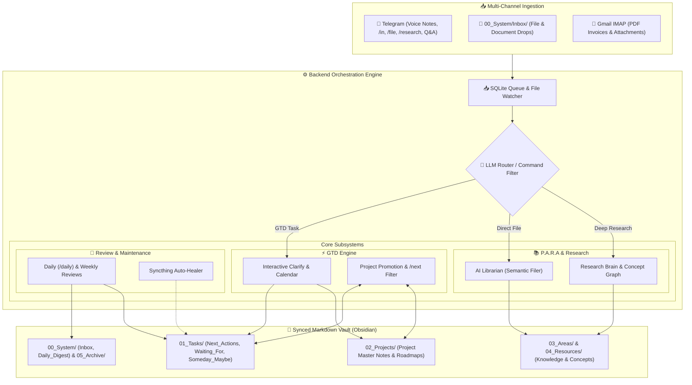

# 🧠 Second Brain (GTD + P.A.R.A Fusion)

> **An Agentic Personal Knowledge & Task Operating System for Obsidian.**  
> Powered by Local CUDA Faster-Whisper, SQLite-VSS Vector Search, and Google Gemini.

[](https://python.org)
[](https://fastapi.tiangolo.com)
[](https://obsidian.md)
[](https://ai.google.dev)
[](LICENSE)

---

## 📑 Table of Contents

- [Overview & Philosophy](#-overview--philosophy)
- [Key Capabilities](#-key-capabilities)
- [Telegram Command Reference](#-telegram-command-reference)
- [Vault Hierarchy (GTD + P.A.R.A)](#-vault-hierarchy-gtd--para)
- [System Architecture](#-system-architecture)
- [Installation & Setup](#-installation--setup)
- [Configuration Reference](#-configuration-reference)
- [Documentation Index](#-documentation-index)
- [Development](#-development)
- [License](#-license)

---

## 💡 Overview & Philosophy

The **Second Brain** operates on the **"Agent-as-Librarian"** paradigm: an intelligent background daemon running 24/7 on your personal machine that actively triages, organizes, links, and surfaces information over a passive, 100% private Markdown vault.

### Why Second Brain?
* **Absolute Data Ownership:** No proprietary cloud databases or walled gardens. Your tasks, project roadmaps, and knowledge graphs exist as standard Markdown files and local SQLite databases.
* **GTD + P.A.R.A Fusion:** Unifies David Allen's **Getting Things Done (GTD)** actionable workflows (`Next_Actions`, `Waiting_For`, `Someday_Maybe`) with Tiago Forte's **P.A.R.A** organizational structure (`Projects`, `Areas`, `Resources`, `Archive`).
* **Zero-Friction Voice & Text Capture:** Dictate thoughts while driving or walking. Local GPU Whisper transcribes and queues them for structured triage.
* **Proactive Project Momentum:** Completing an action in Telegram or Obsidian automatically triggers the system to prompt and promote the next step from your project roadmap.
* **Zero-to-Low Cost:** Designed to run entirely on local compute and Google Gemini / Cloud free tiers.

---

## ✨ Key Capabilities

### 1. 📥 Frictionless Multi-Channel Capture
* **Voice Notes (Telegram):** Send raw voice notes to your Telegram bot. Transcribed locally via `faster-whisper` on CUDA GPU with multi-topic splitting.
* **Quick Text (Telegram):** Capture quick thoughts via `/in <text>` in Telegram.
* **Direct Filing (Telegram):** Send `/file <URL/doc>` to bypass GTD triage and file documents straight into P.A.R.A reference folders.
* **Drop Folder:** Drop PDFs, notes, or audio files into `00_System/Inbox/` for automatic ingestion.
* **Gmail IMAP Poller:** Auto-polls your email for flagged receipts, invoices, and PDF attachments, extracting content and filing it directly to your vault.

### 2. ⚡ Interactive Clarification Engine (`/clarify`)
* Triages captured items in manageable 5-item batches using an 8-option decision tree:
  `[Next Action]` `[Project Roadmap]` `[New Project]` `[Waiting For]` `[Someday/Maybe]` `[AI Librarian]` `[2-Min Rule]` `[Trash]`.
* **1-Tap AI Smart Defaults:** High-confidence recommendations automatically pre-tag context and project links.
* **Inline Calendar Picker:** Natural date deferrals (`🔔 YYYY-MM-DD`) and ticklers using a dynamic visual keyboard calendar.

### 3. 🎯 Dynamic Project Master Notes & Step Auto-Promotion
* Projects in `02_Projects/` maintain a structured **Desired Outcome**, **`## Project Steps`** future roadmap backlog, and dynamic **Dataview** active task views.
* **Automated Step Promotion:** Whenever a project action is completed via **Telegram `/done`** or checked off **`- [x]` in Obsidian**:
  1. The bot inspects the project roadmap.
  2. Pings Telegram with candidate steps: `[1. Step A]` `[2. Step B]`.
  3. Prompts for context (`@home`, `@computer`, `@errands`, `@phone`, `@anywhere`, `@office`).
  4. Appends the promoted action to `Next_Actions.md` and deletes it from `## Project Steps`.

### 4. 🌅 Action-Oriented Daily & Weekly Reviews
* **Daily Review (`/daily` & Morning Briefing — 07:30 Mon–Fri, 10:00 Sat–Sun):**
  - 🚨 Upcoming deadlines (projects with `due_date` <= 14 days).
  - 🔔 Surfaced ticklers unlocking today.
  - ⚡ Active Next Actions grouped by context (`@home`, `@computer`, `@errands`, etc.).
  - ⏳ Active delegated `Waiting For` items.
* **Weekly Review (`/reflect` & Friday 14:00 Briefing):**
  - Audits orphaned projects (0 active next actions), stale waitings (>5 days), and Someday/Maybe ideas.
  - Synthesizes newly learned research concepts from the past 7 days.
* **Holiday Pause Mode (`/holiday`):** Pauses daily/weekly briefings by scope (`Personal`, `Professional`, `All`) with calendar date return selection.
* **Personal / Professional split:** `Next_Actions.md`, `Waiting_For.md` and `Someday_Maybe.md` are rendered in `## 🏠 Personal` and `## 💼 Professional` sections (each ordered overdue → due today → upcoming → backlog), and the reviews and Telegram summaries report them the same way. `Captured.md` stays flat; `/clarify` asks for the category, including for Someday/Maybe items.

### 5. 📚 Deep Research Knowledge Graph (`/research`)
* Ingests web articles, YouTube transcripts, PDFs, and slide decks (`.pptx`).
* Uses Gemini with **Context Caching** to extract dense summaries and 5–15 atomic concept nodes bidirectionally linked in `04_Resources/Research_Brain/Concepts/`.

### 6. 💬 Conversational Vault Q&A (RAG)
* Ask plain-text natural language questions in Telegram without command prefixes.
* Retrieves relevant context using `sqlite-vss` vector search with a 5-turn conversational context memory window.

### 7. 🛡️ Syncthing Auto-Healer
* Monitors for multi-device Syncthing sync conflicts (`*.sync-conflict-*.md`).
* Conflicts on the task lists (`Next_Actions`, `Waiting_For`, `Someday_Maybe`, `Captured`) are union-merged: an open task on either device is kept, and a tick on either device wins and is archived to `z_Completed.md`. A merge that would drop an open task is refused and left for you.
* Both copies are backed up to `backend/state/task_backups/` (kept 30 days, outside the synced vault) and committed to Git before anything is written.
* `01_Tasks/` is also committed to Git (`[tasks] …` commits, which `/undo` skips over) about a minute after the server changes it, only when something changed.
* Recommended: enable Syncthing *Staggered File Versioning* on the vault folder so edits made on other devices are versioned too.

### 8. 📱 GTD Web App
* An installable web app (laptop and phone) for working through your lists: pick **Personal** or **Professional**, then **Next**, **Waiting**, **Someday**, **Captured** or **Projects**.
* **Capture** with the **+** button: type a thought, or tap the mic and say it. Voice notes are transcribed on the server and stored exactly as Telegram voice notes are.
* **Clarify** a captured item on one sheet: fix the wording, choose what it is (next action, waiting for, someday, project step, new project, done, reference, trash), fill in only what that needs. The same outcomes as `/clarify`; use whichever is to hand.
* **Projects**: see each project's outcome, open actions and roadmap; add, reorder and promote roadmap steps; create, archive and restore projects. A project with nothing in Next or Waiting is flagged **Stuck**. Completing a project's action offers its next roadmap step.
* Drag actions into priority order, tick them off (with Undo), edit text, context and dates, and move them between Next / Waiting For / Someday.
* The order you drag is the order of the lines in the Markdown file, so Obsidian and Telegram show the same priorities.
* Works offline: changes queue on the device and replay when it reconnects. An action that was changed elsewhere in the meantime is skipped and flagged rather than overwritten.
* Served by the backend at `/app` — see [GTD Web App setup](#6-gtd-web-app-optional).

---

## 🤖 Telegram Command Reference

| Command | Description |
| :--- | :--- |
| *(plain text)* / `/ask` / `/query` | **Conversational Q&A** — Natural language queries against your vault with 5-turn context memory. |
| *(voice note)* | **Audio Capture** — Transcribes via Gemini and saves to `01_Tasks/Captured.md` (questions are answered instead). The transcript lives only in `Captured.md`; the audio waits in `00_System/Inbox/` (expires after 30 days) until `/clarify` moves it to `Inbox/Archive/` (kept 90 days). |
| `/in <text>` / `/capture` | **GTD Capture** — Append a raw capture directly to `01_Tasks/Captured.md`. |
| `/file <URL/doc>` | **Direct PARA Filing** — Routes directly to AI Librarian, bypassing GTD clarify triage. |
| `/research <URL>` | **Deep Research** — Ingests content into Research Brain with full knowledge graph concept extraction. |
| `/clarify` | **Interactive Triage** — Process captured items in 5-item batches with inline buttons & calendar picker. |
| `/next [@context]` / `/actions` | **Context Execution** — Bare `/next` offers a Personal / Professional / Both picker; `/next @context` filters directly (`@home`, `@computer`, `@errands`, `@phone`, `@anywhere`, `@office`, `@WFH`). |
| `/waiting` | **Delegated Tracking** — View pending items owed by others with age and follow-up dates. |
| `/project <name>` | **Project Dashboard** — View Desired Outcome, Active Actions, Roadmap Steps, and References. |
| `/project <name> add <step>` | **Roadmap Backlog** — Append a new future step to `## Project Steps` in a project note. |
| `/archive <name>` / `/archive-project` | **Archive Project** — Sets `status: completed` and moves the whole project folder to `05_Archive/02_Projects/<Category>/`. |
| `/done <item>` | **Complete Action** — Archives task to `01_Tasks/z_Completed.md` and triggers 1-tap step promotion. |
| `/tickle <item>` | **Defer Task** — Opens visual calendar picker to set a `🔔 YYYY-MM-DD` tickler date; deferred items are hidden until that date. |
| `/daily` | **Daily Review** — On-demand action review (deadlines <=14d, surfaced ticklers, next actions by context). |
| `/weekly` / `/status` / `/sitrep` | **System Sitrep** — High-level counts across all GTD task lists, active projects, and 7-day completed actions. |
| `/reflect` | **Guided Review** — Step-by-step interactive weekly reflection (inbox zero, stale waitings, orphaned projects, Someday/Maybe). |
| `/holiday` | **Pause Reviews** — Pause automated briefings by scope (`Personal`, `Professional`, `All`) via calendar picker, or type a date directly (`/holiday personal 23rd Aug`). |
| `/jira <summary>` | **Jira Export** — Create a ticket directly in Jira backlog. |
| `/undo` | **Safety Revert** — Shows the last vault commit and its files, then reverts it on confirmation. Only `[orchestrator]` commits can be reverted; hand-made commits are refused. |
| `/help` | **Help Menu** — Full command reference and workflow examples. |

---

## 📂 Vault Hierarchy (GTD + P.A.R.A)

```text
vault/
├── 00_System/
│   ├── Inbox/                     <-- CAPTURE STAGING (raw items & drops)
│   │   └── Archive/               <-- Clarified source files kept for traceability
│   ├── Internal/
│   │   └── Digests/               <-- Rolling archive of daily digests (14-day retention)
│   ├── Daily_Digest.md            <-- Latest daily review briefing
│   ├── _INDEX.md                  <-- Auto-generated vault sitemap
│   └── Librarian_Activity.md      <-- Ingestion and filing audit log
├── 01_Tasks/                      <-- GTD ACTION HUB
│   ├── Next_Actions.md            <-- ⚡ Context-tagged actions (@home, @computer, etc.)
│   ├── Waiting_For.md             <-- ⏳ Delegated actions (#waiting(Name))
│   ├── Someday_Maybe.md           <-- 💡 Future ideas & uncommitted desires
│   ├── Captured.md                <-- 📥 Raw captures awaiting /clarify
│   └── z_Completed.md             <-- ✅ Archived completed actions (newest first)
├── 02_Projects/                   <-- ACTIVE PROJECTS
│   ├── Personal/                  <-- Personal projects & deliverables
│   └── Professional/              <-- Work & career deliverables
├── 03_Areas/                      <-- ONGOING RESPONSIBILITIES (Family, Health, Coding)
├── 04_Resources/                  <-- REFERENCE & RESEARCH BRAIN
│   └── Research_Brain/
│       ├── Concepts/              <-- Atomic concept pages with bidirectional links
│       ├── Sources/               <-- Raw source transcripts and ingested files
│       └── Summaries/             <-- Structured AI summary nodes
└── 05_Archive/                    <-- COMPLETED DELIVERABLES & HISTORICAL ARCHIVE
```

---

## 🏛️ System Architecture



---

## 🚀 Installation & Setup

### 1. Prerequisites
- **OS:** Linux (e.g. Fedora Server / Ubuntu), macOS, or WSL2.
- **Python:** Python 3.11+
- **Package Manager:** [`uv`](https://github.com/astral-sh/uv) (recommended) or standard Python `venv`.
- **Obsidian:** Installed locally on desktop or mobile.
- **Telegram Bot:** Create a bot via [@BotFather](https://t.me/BotFather) on Telegram and obtain your API Token.
- **Google AI Studio Key:** Obtain a free API Key from [aistudio.google.com](https://aistudio.google.com).
- *(Optional GPU):* NVIDIA GPU with CUDA drivers for local Whisper transcription of audio files dropped into `00_System/Inbox/` (falls back to CPU, then Gemini). Telegram voice notes are always transcribed by Gemini.

---

### 2. Clone & Install Backend

```bash
# 1. Clone repository
git clone https://github.com/sdmeers/second_brain.git second_brain
cd second_brain/backend

# 2. Create virtual environment and install dependencies using uv
uv venv
uv sync

# 3. Create environment configuration
cp .env.example .env
```

---

### 3. Configure Environment (`backend/.env`)

Edit `backend/.env` with your personal paths and keys:

```ini
# Vault Path
OBSIDIAN_VAULT_PATH=/home/username/vault
PORT=8080   # code default; must match extension/config.js

# LLM & Embedding Settings
LLM_PROVIDER=gemini
LLM_MODEL=gemini-3.1-flash-lite
EMBEDDING_PROVIDER=gemini
EMBEDDING_MODEL=gemini-embedding-2
GEMINI_API_KEY=AIzaSy...

# Telegram Bot Configuration
ENABLE_TELEGRAM_BOT=true
TELEGRAM_BOT_TOKEN=1234567890:ABCdef...
TELEGRAM_ALLOWED_CHAT_IDS=123456789

# Ingestion Toggles
ENABLE_OBSIDIAN_INBOX_POLLING=false
ENABLE_GMAIL_POLLING=false
```

---

### 4. Vault Setup & First Run

1. Open your Obsidian Vault folder and create the core directories:
   `00_System/Inbox`, `01_Tasks`, `02_Projects/Personal`, `02_Projects/Professional`, `03_Areas`, `04_Resources/Research_Brain`, `05_Archive`.
2. Launch the backend locally to initialize databases and vector indexes:
   ```bash
   cd second_brain/backend
   uv run python3 -m backend.main
   ```
3. Open Telegram, start a chat with your bot, and send `/help` or `/status` to confirm connectivity.

---

### 5. Run Persistently with systemd (Linux)

To run the Second Brain 24/7 as a background service on Linux:

```bash
# 1. Create systemd user service file
mkdir -p ~/.config/systemd/user/
cat << 'EOF' > ~/.config/systemd/user/second-brain.service
[Unit]
Description=Second Brain Orchestrator Daemon (GTD + PARA)
After=network.target

[Service]
Type=simple
WorkingDirectory=/home/username/second_brain
ExecStart=/home/username/second_brain/backend/.venv/bin/python3 -m backend.main
Restart=always
RestartSec=5

[Install]
WantedBy=default.target
EOF

# 2. Enable and start service
systemctl --user daemon-reload
systemctl --user enable second-brain.service
systemctl --user start second-brain.service

# 3. Verify status
systemctl --user status second-brain.service
```

Logs are in the **user** journal — `journalctl --user -u second-brain.service -f`. Plain
`journalctl -u ...` reads the system journal and shows nothing.

The scheduled briefings are separate units, not part of the daemon. Templates are in
[`docs/systemd/`](docs/systemd/):

| Timer | Schedule | Runs |
| :--- | :--- | :--- |
| `second-brain-cleaner.timer` | Mon–Fri 07:30, Sat–Sun 10:00 | `python3 -m backend.brain_cleaner` (daily digest and maintenance) |
| `second-brain-weekly-review.timer` | Fri 14:00 | `python3 -m backend.brain_cleaner --weekly-review` |

They call `backend/.venv/bin/python3` directly rather than `uv run`, so run `uv sync` after
changing dependencies or the timers will run against a stale environment.

### 6. GTD Web App (optional)

The app is a static build served by the backend itself, so it needs no hosting of its own.

```bash
# 1. Build it (Node 20+). Re-run after pulling changes to webapp/.
cd webapp
npm install
npm run build

# 2. Restart the backend so it picks up webapp/dist
systemctl --user restart second-brain.service
```

It is now at `http://<server>:<PORT>/app/` (`PORT` from `backend/.env`, default 8080). To use it from your phone, away from home, and
offline, it needs HTTPS — browsers only allow install-to-home-screen and offline caching
on secure origins. With [Tailscale](https://tailscale.com) on the server and your devices:

```bash
# On the server: publish the backend's port to your tailnet over HTTPS (not to the internet)
tailscale serve --bg 8080   # use your PORT if it isn't 8080
```

Then open `https://<server>.<tailnet>.ts.net/app/` on any device signed in to your
tailnet and choose **Install** / **Add to Home Screen**. Set `API_AUTH_TOKEN` in
`backend/.env` and the app asks for it once per device.

Voice capture needs that HTTPS address too (browsers only allow the microphone on secure
origins) and asks for microphone permission the first time. Recordings are transcribed
with Gemini, as Telegram voice notes are.

For frontend development, `npm run dev` in `webapp/` serves the app with hot reload and
proxies `/api` to a backend on `localhost:8080`.

---

## ⚙️ Configuration Reference

| Environment Variable | Default | Description |
| :--- | :--- | :--- |
| `OBSIDIAN_VAULT_PATH` | *Required* | Absolute path to the Obsidian Vault directory. |
| `GEMINI_API_KEY` | *Required* | Google AI Studio API key for Gemini models and embeddings. |
| `LLM_PROVIDER` | `gemini` | Primary LLM provider (`gemini`, `openai`, `ollama`). |
| `LLM_MODEL` | `gemini-3.1-flash-lite` | Target model for routing, summarization, and RAG Q&A. |
| `EMBEDDING_PROVIDER` | `gemini` | Embeddings provider (`gemini`, `openai`, `ollama`). |
| `EMBEDDING_MODEL` | `gemini-embedding-2` | Target embedding model for `sqlite-vss`. |
| `EMBEDDING_TEXTS_PER_MINUTE` | `2500` | Ceiling for texts sent to the embedding API in any trailing 60 s. The Gemini quota counts texts, not requests; lower this if re-indexing hits sustained 429s. |
| `EMBEDDING_BATCH_SIZE` | `100` | Chunks per embedding request. |
| `PORT` | `8080` | HTTP port for `/process`, `/query` and `/health`. Must match `extension/config.js`. |
| `ENABLE_OBSIDIAN_INBOX_POLLING` | `false` | Watches `00_System/Inbox/` for dropped files and `Inbox.md`. |
| `TELEGRAM_BOT_TOKEN` | *Optional* | Telegram Bot API token from @BotFather. |
| `TELEGRAM_ALLOWED_CHAT_IDS` | *Optional* | Comma-separated list of authorized Telegram chat IDs. |
| `ENABLE_TELEGRAM_BOT` | `true` | Enables unified Telegram bot polling loop. |
| `ENABLE_GMAIL_POLLING` | `false` | Enables IMAP polling for incoming attachments. |
| `API_AUTH_TOKEN` | *Optional* | Shared secret for `/process`, `/query` and `/api/actions`. When set, callers must send `Authorization: Bearer <token>`. Unset leaves the API open. |
| `JIRA_URL` | *Optional* | Base URL for Atlassian Jira instance. |
| `JIRA_USER_EMAIL` | *Optional* | User email for Jira API basic auth. |
| `JIRA_API_TOKEN` | *Optional* | Atlassian API token for Jira ticket creation. |

**LLM prompts** are not configured through the environment: every system prompt lives as a Markdown file in [`backend/prompts/`](backend/prompts/) (`router.md`, `para_librarian.md`, `brain_node.md`, …). Edit the file, then restart the service.

---

## 📖 Documentation Index

Comprehensive guides are located in the `docs/` directory:
* **[User Guide & Workflows](docs/user_guide.md):** Complete day-to-day manual for GTD triage, contexts, reviews, and project management.
* **[Technical Implementation](docs/technical_implementation.md):** Backend schemas, state machines, and system module breakdown.
* **[Manual Testing](docs/manual_testing.md):** Verification plan for behaviour the automated suite cannot cover.
* **[Changelog](docs/changelog.md):** What changed and why, most recent first.
* **[Product Description](docs/product_description.md):** Architectural vision, value proposition, and core capabilities.

---

## 🧪 Development

```bash
cd backend
uv run pytest              # ~320 tests, ~2s — no vault, API key or network required
uv run ruff check .        # lint; must pass clean
uv run ruff check . --fix  # apply safe autofixes

cd ../webapp
npm run build              # type-check and build the actions web app
npm run lint
```

Tests build a throwaway vault in `tests/conftest.py`, so they never touch your real one.

**Two conventions matter when working on the backend:**

1. **Use `backend/vault/tasks.py` for anything touching task lines or project notes** —
   `parse_task_line`, `strip_task_metadata`, `archive_completed_lines`,
   `find_project_note`, `read_project`, `dump_frontmatter`. It is the single source of
   truth for the formats in
   [technical_implementation.md](docs/technical_implementation.md) §2 and §6. Independent
   copies of these parsers drifting apart has been a recurring source of silent bugs.
2. **Restart the service after any backend change** — code edits do not take effect until
   you do:
   ```bash
   systemctl --user restart second-brain.service
   systemctl --user status second-brain.service
   journalctl --user -u second-brain.service -f
   ```

---

## 📄 License

Distributed under the **MIT License**. See [`LICENSE`](LICENSE) for details.
