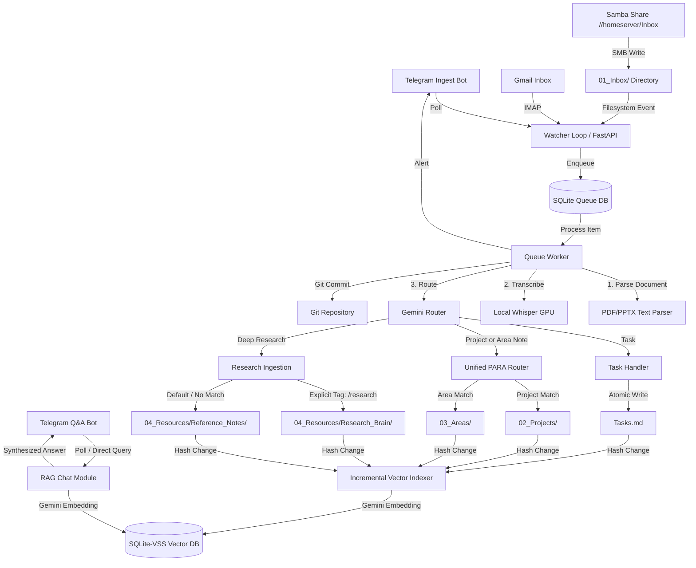
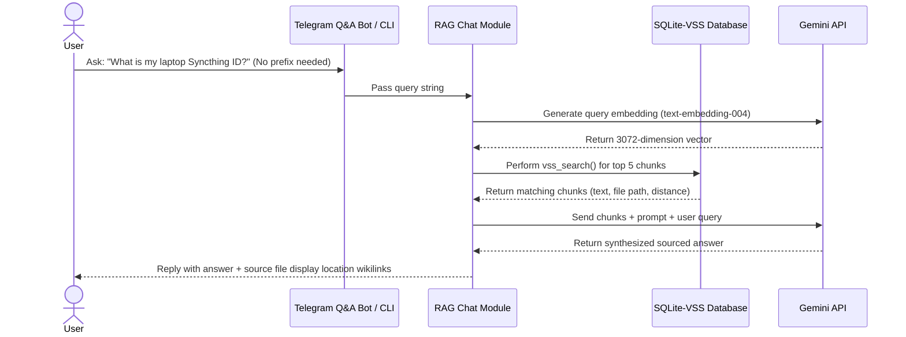

# 🛠️ Second Brain: Technical Implementation

This document describes the technical architecture, data structures, and optimization choices for the Second Brain orchestrator.

---

## 1. Architectural System Overview

The orchestrator operates as a Python FastAPI daemon running under systemd. It handles asynchronous event queues, file-system watching, external API integration, local machine learning models, and relational vector storage.



---

## 2. Document & PPTX Parsing Pipeline
To allow highly accurate classification and filing, the queue worker parses text contents of documents **before** invoking the router:
*   **PDF Extractor:** Uses `PyMuPDF` (`fitz`) to extract plain text layout.
*   **PowerPoint (PPTX) Extractor:** Uses `python-pptx` to parse all slide shapes (paragraphs, text boxes, and table cells) and merges them with **Speaker Notes** to capture the complete presentation narrative.
*   **Redundant Copy Prevention:** If the ingested raw file is an editable text file (`.md` or `.txt`), the system writes only the final processed markdown note. Original binaries (PDFs, PPTX, MP3s, images) are copied next to the note as a `_raw` file.

---

## 3. Ingestion Queue Database Schema

The persistent queue runs on SQLite (`backend/second_brain.db`) with `PRAGMA journal_mode=WAL` (Write-Ahead Logging) and a `timeout=30.0` configuration to ensure safe, concurrent daemon/CLI writes without database locks.

### Table: `ingestion_queue`
```sql
CREATE TABLE IF NOT EXISTS ingestion_queue (
    id INTEGER PRIMARY KEY AUTOINCREMENT,
    source_type TEXT NOT NULL,       -- 'telegram', 'file_drop', 'gmail'
    status TEXT DEFAULT 'pending',   -- 'pending', 'processing', 'completed', 'failed'
    raw_payload TEXT,                -- JSON dump of original metadata
    content_text TEXT,               -- Raw or transcribed textual content
    file_path TEXT,                  -- Reference to permanent file (e.g. PDFs)
    attempts INTEGER DEFAULT 0,
    error_msg TEXT,
    created_at TIMESTAMP DEFAULT CURRENT_TIMESTAMP,
    updated_at TIMESTAMP DEFAULT CURRENT_TIMESTAMP
);
```

---

## 4. Vector Database Schema (RAG)

Vector chunks and indexing are stored in `backend/brain_vectors.db` using the `sqlite-vss` extension (running in WAL mode).

### Table: `brain_chunks` (Metadata)
Stores the text chunks, file paths, and hashes for incremental updates.
```sql
CREATE TABLE brain_chunks (
    id INTEGER PRIMARY KEY AUTOINCREMENT,
    file_path TEXT,                  -- Vault-relative path
    chunk_index INTEGER,             -- Order of chunk in file
    text_content TEXT,               -- Plain text segment
    file_hash TEXT,                  -- MD5 hash of file to check modifications
    updated_at TIMESTAMP DEFAULT CURRENT_TIMESTAMP
);
```

### Table: `vss_brain_chunks` (Virtual Vector Table)
A virtual table managed by the `vss0` module. It maps directly to `brain_chunks` via the `rowid`.
```sql
CREATE VIRTUAL TABLE vss_brain_chunks USING vss0(
    vector(3072)                     -- Fits Gemini text-embedding-004 dimensions
);
```

---

## 5. RAG Query Flow

The retrieval augmented generation pipeline operates as follows (bypassing the ingestion queue entirely for instant responses):



---

## 6. Pascal GPU Whisper Optimization

To support the Pascal architecture of your **GTX 1070**, the `faster-whisper` loader implements a fallback chain to prevent driver/linker failures.

Pascal GPUs do not support FP16 tensor core math and will throw a `ValueError` on initialization. The transcriber tries compute types in the following order:
1.  **`cuda / float16`**: Fast on Turing/Ampere+ GPUs. Fails gracefully on Pascal.
2.  **`cuda / float32`**: Loaded next. Fully supported by the GTX 1070 CUDA cores, ensuring hardware-accelerated transcription.
3.  **`cuda / int8`**: Fallback in case of low memory.
4.  **`cpu / int8`**: Run locally on CPU as a last resort.
5.  **`Gemini API Transcription`**: Cloud fallback if local libraries fail.

---

## 7. Atomic Write Safety

To protect your vault markdown files from truncation or corruption if the homeserver restarts mid-write, all filesystem operations go through an atomic writing wrapper:

1.  The content is written to a temporary file in the same directory (e.g. `note.md.tmp`).
2.  The file handle is closed, guaranteeing that the write to disk is complete.
3.  `os.replace()` is called to swap the `.tmp` file with the target file.
4.  On Unix/Linux, `os.replace` is an atomic system call, meaning the note is either fully written or completely unchanged.
