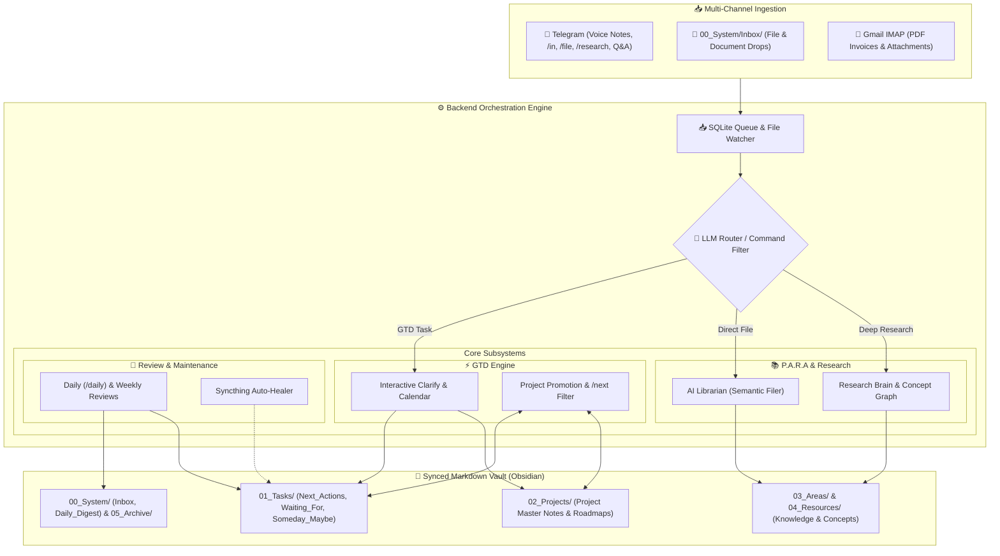

# 🛠️ Second Brain: Technical Implementation

This document details the backend architecture, data models, state machines, and system integrations for the **GTD + P.A.R.A Second Brain**.

---

## 1. System Architecture Overview



---

## 2. Task Line Schema & Field Formats

Tasks across `01_Tasks/` adhere to a standardized line format:
```text
- [ ] <description> @<context> #project/<name> #<category> 📅 YYYY-MM-DD 🔔 YYYY-MM-DD (Source: [[...]])
```

| Field | Format | Purpose & Behavior | Required? |
| :--- | :--- | :--- | :--- |
| **Status Checkbox** | `- [ ]` / `- [x]` | Completed items marked with `- [x] ~~text~~ (Completed on YYYY-MM-DD)`. | Yes |
| **Description** | `<text>` | Clean, action-oriented task summary. | Yes |
| **`@<context>`** | `@home`, `@computer`, `@errands`, `@phone`, `@anywhere`, `@office`, `@WFH` | Context execution filter used in `/next @context` and Daily Review. | Next Actions |
| **`#project/<name>`** | `#project/Project_Name` | Links task to master project note in `02_Projects/`. | Optional |
| **`#<category>`** | `#personal`, `#professional` | Scope tag used for holiday pausing and weekend filtering. | Optional |
| **`#waiting(Name)`** | `#waiting(Steven)` | Owner tracking for delegated tasks in `Waiting_For.md`. | Waiting For |
| **`📅 YYYY-MM-DD`** | `📅 2026-08-23` | Hard deadline / scheduled date (triggers <=14d alerts). | Optional |
| **`🔔 YYYY-MM-DD`** | `🔔 2026-08-20` | Tickler date (item hidden until this date, surfaces on `/daily`). | Optional |
| **`Source Link`** | `(Source: [[00_System/Inbox/Archive/file.md]])` | Traceability backlink to original capture. | Auto-generated |

---

## 3. Project Directory & Master Note Specification (`02_Projects/`)

All projects are organized into dedicated subdirectories under `02_Projects/Personal/<Project_Name>/` or `02_Projects/Professional/<Project_Name>/`:
- **Directory Layout:**
  - `<Project_Name>.md` (Master summary note at the root of the folder)
  - `Notes/`, `Meetings/`, `Outputs/` (Optional subfolders for meeting minutes, deliverables, and drafts)
  - Attachments, images, and reference documents.

````markdown
---
title: "Project Title"
type: project
category: Personal # Personal | Professional
outcome: "Clear definition of done"
due_date: "" # Optional YYYY-MM-DD or DD-MM-YYYY
date_created: "2026-08-08"
status: active # active | completed | on-hold
---
# Project Title

## Desired Outcome
Detailed statement of the desired end-state.

## Project Steps
- [ ] Future roadmap step 1
- [ ] Future roadmap step 2

## Active Actions
> View via Telegram: `/project Project_Title` or search `#project/Project_Title` in Obsidian.

```dataview
TASK
FROM "01_Tasks"
WHERE contains(tags, "#project/Project_Title") AND !completed
```

## Reference Material
- [[Linked Note 1]]
````

---

## 4. Backend Subsystems & Module Breakdown

### 4.1 Ingestion Watcher & Router (`watcher.py`)
- Background polling loop (15 s tick) monitoring the SQLite ingestion queue and `00_System/Inbox/`.
- **Pipeline stages** — the queue worker is split into discrete, individually testable steps:
  1. `prepare_content()` — turns an attachment into classifiable text (Whisper transcription for audio, PyMuPDF/python-pptx extraction for documents, multimodal OCR for images). Extracted text is cached back onto the queue row so a retry never re-transcribes.
  2. `classify_item()` — runs the LLM router, honouring the deterministic `/research` override.
  3. Routing — deep research, task, voice dump, instruction, PARA note (`route_para_note()`), URL capture, or fallback.
  4. `finalise_item()` — completed log, Git commit, incremental indexing, tag/wikilink enrichment, Telegram notification. Each step is guarded independently so a failure in indexing cannot lose the note.
- **Deterministic Slash Override:** Commands like `/research`, `#research`, or `/file` bypass generic classifier heuristics to route directly to their target pipelines. `detect_research_request()` searches the body and the email subject *separately*, so a trigger phrase cannot match by spanning the two.
- **Document detection:** `looks_like_document()` checks the file extension, then the URL path, then falls back to an HTTP `HEAD` content-type probe — which catches PDFs served without a `.pdf` suffix (arXiv links, datasheets).
- **PARA note writing:** `write_para_note()` is the single implementation used for both `03_Areas` matches and `02_Projects/Ideas`, including raw-source-file copying and filename collision resolution.
- **Auto-Healer:** Detects and resolves Syncthing sync conflicts by performing line-level merges (preserving `- [x]` completion state) and committing the result to Git. Detection requires either Syncthing's own `.sync-conflict-` marker, or a `-XXXXXXX.md` device suffix **whose base file actually exists** — without that second condition an ordinary note such as `Notes-ABC1234.md` matched, and the healer would move or delete it.

### 4.2 Clarify State Machine (`clarify.py`)
- Manages interactive multi-stage triage sessions over Telegram callback queries.
- **8-Option GTD Triage:** Next Action, Project Roadmap, New Project, Waiting For, Someday/Maybe, AI Librarian, 2-Min Rule, Trash.
- **Waiting For Flow:** Prompts for contact/entity name (`#waiting(Name)`) and optional project link before filing to `01_Tasks/Waiting_For.md`.
- **Dynamic Project Picker:** Scans `02_Projects/Personal` and `02_Projects/Professional` to render 2-column inline buttons for rapid project association.
- **Batch Processing:** Processes 5 items per run with inline `[▶️ Continue]` / `[⏸️ Pause]` controls.

### 4.3 Telegram Inline Calendar Engine (`telegram_calendar.py`)
- Generates dynamic visual keyboard calendars for natural date selection.
- Features month navigation (`◀ August 2026 ▶`), day-of-week headers, and day buttons.
- Standardizes output dates into ISO format (`YYYY-MM-DD`) across `/clarify` deferrals, `/tickle`, and `/holiday`.

### 4.4 Engage & Step Auto-Promotion Engine (`engage.py` & `tasks_dashboard.py`)
- Powers `/next`, `/waiting`, `/project`, `/done`, `/daily`, `/weekly` / `/status`, and `/reflect`.
- **Dual-Trigger Step Auto-Promotion:** When an action with `#project/<tag>` is completed via Telegram `/done` OR checked off `- [x]` in Obsidian:
  1. Locates the project note in `02_Projects/`.
  2. Extracts unchecked roadmap steps from `## Project Steps`.
  3. Sends an interactive Telegram prompt with candidate step buttons.
  4. Upon context selection, appends `- [ ] <step> @<context> #project/<tag>` to `Next_Actions.md` and deletes the line from `## Project Steps`.

### 4.5 Guided Reflection Engine (`engage.py`)
- Interactive, multi-step review state machine triggered via `/reflect`:
  - **Step 1:** Get Clear (Inbox Zero audit with 1-tap `/clarify` launch).
  - **Step 2:** Audit Delegations (all `Waiting_For.md` items with `⚠️ STALE >5d` detection).
  - **Step 3:** Project Momentum (identifies orphaned projects with 0 active actions and displays candidate roadmap step promotion buttons).
  - **Step 4:** Someday / Maybe activation review.
  - **Step 5:** Project deadlines (`due_date <= 14d`) and 7-day accomplishment celebration.

### 4.6 Holiday Pause Manager (`holiday_manager.py`)
- Allows pausing automated review briefings while away.
- Persists holiday state (`holiday_active`, `return_date`, `scope`) across restarts.
- Scopes supported: `Personal`, `Professional`, `All`.
- Automatically suppresses daily digests and weekly reviews during active holiday windows.

### 4.7 Deep Research & Concept Knowledge Graph (`capture.py` & `brain_node.py`)
- Triggered deterministically via `/research <URL>` or academic document ingestion.
- Uses Gemini with **Context Caching** (`google-genai` SDK) to extract dense summaries and 5–15 atomic concepts.
- **Concept Updater Loop:** Atomically updates or creates bidirectional concept notes in `04_Resources/Research_Brain/Concepts/` with rate-limiting throttling.

### 4.8 Review & Maintenance Engine (`brain_cleaner.py`)
- **Daily Review (`/daily` & 07:30 run):** Gathers upcoming project deadlines (<= 14 days, strictly parsed from top-level project YAML frontmatter), surfaced ticklers (`🔔 == today`), active Next Actions grouped by `@context`, and pending Waiting items.
- **Weekly Review (Friday 07:30 run):** Performs deep audit of Someday/Maybe ideas, orphaned projects, stale waitings, completed tasks, and AI research synthesis.

---

## 5. Systemd Service Management

The system operates as a persistent user service:

```ini
# ~/.config/systemd/user/second-brain.service
[Unit]
Description=Second Brain Orchestrator Daemon (GTD + PARA)
After=network.target

[Service]
Type=simple
WorkingDirectory=/home/sdmeers/second_brain/backend
ExecStart=/home/sdmeers/.local/bin/uv run main.py
Environment=PYTHONPATH=/home/sdmeers/second_brain
Environment=PYTHONUNBUFFERED=1
Restart=always
RestartSec=5

[Install]
WantedBy=default.target
```

`PYTHONPATH` pointing at the repository root is what lets `backend` resolve as a package
from inside `main.py`. `main.py` also inserts the repo root onto `sys.path` itself, so
running `python3 -m backend.main` from the repo root works equally well.

> **Note:** `main.py` imports `app` from `backend.api.routes` at module level. It looks
> unused, but `uvicorn.run("backend.main:app", ...)` resolves that name at runtime — do
> not let an autofixer strip it (it carries an explicit `# noqa: F401`).

---

## 6. Shared Vault Parser (`backend/vault/tasks.py`)

**All task-line and project-note parsing goes through this module.** Before it existed the
line format in §2 was re-implemented with ad-hoc regexes across `engage.py`, `clarify.py`,
`tasks_dashboard.py`, `instruction.py` and `watcher.py`, and those copies drifted apart —
which is how several silent failures arose (`Completed.md` vs `z_Completed.md`,
`00_System/Tasks.md` vs `01_Tasks/Next_Actions.md`).

| Helper | Purpose |
| :--- | :--- |
| `parse_task_line(line) -> Task \| None` | Parses every documented field into a dataclass (`description`, `contexts`, `project`, `category`, `waiting_on`, `due`, `tickler`, `source`, `completed_on`). `raw` is preserved verbatim. |
| `render_task_line(...)` | Emits a line in the canonical field order of §2. |
| `strip_task_metadata(line)` | Returns the clean human-readable description. |
| `iter_task_lines(path, include_checked=)` | Iterates parsed tasks in a GTD file. |
| `archive_completed_lines(lines)` | The **only** way to write `z_Completed.md`, newest-first. |
| `find_project_note(name)` | Resolves a project by exact filename, directory name, then substring — tolerant of case and `_`/space differences. |
| `read_project(path) -> Project` | Frontmatter (as YAML), `status`, `due_date`, `outcome`, `tag`, and roadmap `steps`. |
| `ensure_project_note(name, category, outcome)` | Finds or creates the master note from the shared template. |
| `append_project_step` / `remove_step_from_project` | Roadmap backlog maintenance. |
| `parse_frontmatter` / `dump_frontmatter` | YAML-safe frontmatter read/write. |

Two rules when working in this codebase:

- **Never use `.strip("- [ ]")`.** `str.strip` takes a *character set*, not a prefix, so it
  silently corrupts any task whose text begins or ends with `[`, `]`, `-` or a space —
  `[Draft] review notes` became `Draft] review notes`. Use `strip_task_metadata()`.
  Ruff's `B005` rule now catches this automatically.
- **Never build frontmatter with f-strings.** Use `dump_frontmatter()`; a title containing
  a quote or a colon (`Phase 1: Discovery`) otherwise emits YAML that both Obsidian and
  `yaml.safe_load` reject.

---

## 7. Ingestion Queue Semantics (`backend/ingestion/queue.py`)

- **Table:** `ingestion_queue (id, source_type, raw_payload, content_text, file_path,
  status, error_message, retry_count, created_at, updated_at)`.
- **Statuses:** `pending` → `processing` → `completed` | `failed`. Items stuck in
  `processing` are reset to `pending` on startup.
- **Draining:** the watcher processes up to **5 items per 15-second tick** (previously
  exactly one, so a backlog of 20 captures took five minutes to clear).
- **Retry backoff:** failed items become eligible again only after `1`, `5`, then `30`
  minutes (`RETRY_BACKOFF_MINUTES`), and are abandoned after `MAX_RETRIES = 3`. Previously
  a failing item retried on the very next tick, producing three failures — and three
  Telegram error messages — inside a minute.
- **Timestamps are UTC throughout.** Inserts use the column default `CURRENT_TIMESTAMP`
  and `update_item_status` uses `CURRENT_TIMESTAMP` too, so the two are comparable. They
  previously disagreed by an hour under BST because updates used Python's local-time
  `datetime.now()`.

---

## 8. Concurrency & Blocking Discipline

The daemon runs two long-lived tasks on one event loop: `watch_inbox_loop` (15-second
tick) and `run_telegram_bot_loop` (10-second long poll). **Anything that blocks the loop
delays Telegram button responses**, so:

- Network calls in `processing/extractor.py` (`extract_web_text`, `extract_pdf_text`,
  `extract_docx_text`, `fetch_cover`) are `async` and use `httpx.AsyncClient`. They were
  synchronous with 30-second timeouts, which froze the bot for the duration of any slow
  site during a capture.
- `commit_vault_changes` (a `subprocess` call that can include a 30-second `git push`)
  runs via `asyncio.to_thread`.
- `ingestion/gmail.py` is the reference pattern for genuinely synchronous work:
  `loop.run_in_executor(...)` wrapped in `asyncio.wait_for`.
- Background tasks created with `asyncio.create_task` are held in a module-level set. The
  loop only keeps weak references, so an unreferenced task can be garbage-collected
  mid-flight.

### Vector Store

The `vss_brain_chunks` virtual table is declared as `vss0(vector(3072))`, matching the
`gemini-embedding-2` dimension. **Changing `EMBEDDING_MODEL` to a model with a different
dimension requires rebuilding this table** — the declared width is fixed at creation.

### Incremental Vector Indexing

`index_vault()` runs after every ingest and every 2 minutes. It caches `st_mtime` and
`st_size` on `brain_chunks` and skips unchanged files without reading them; only when the
stat differs does it hash to confirm a real content change. Zero-byte files are skipped
outright (they produce no chunks, so they stored no cached stat and were re-read forever).
On a 1,696-file / 253 MB vault a full pass went from **0.49 s to 0.04 s**, and now scales
with *changed* files rather than vault size.

### Atomic Vault Writes (`backend/vault/writer.py`)

`atomic_write()` writes to a uniquely-named dot-prefixed temp file **in the same
directory**, `fsync`s, then `os.replace`s. The unique name prevents two concurrent writes
to one target from clobbering each other; the `fsync` prevents a crash leaving a
renamed-but-empty file; the dot prefix keeps Syncthing and Obsidian from picking the temp
file up mid-write.

### Session State (`backend/utils/sessions.py`)

The multi-step Telegram flows (`clarify`, step promotion, `tickle`, Q&A memory) keep state
in a `SessionStore` — a `chat_id`-keyed dict whose entries expire after 30 minutes. State
is deliberately process-local; losing an in-flight flow on restart is correct. Previously
these were bare dicts with no eviction, so abandoned flows leaked and the "session
expired" branches were unreachable.

---

## 9. Testing & Linting

Both are configured in `backend/pyproject.toml`.

```bash
cd backend
uv run pytest              # ~220 tests, ~1.5s
uv run ruff check .        # must pass clean
uv run ruff check . --fix  # apply safe autofixes
```

`backend/tests/conftest.py` creates a throwaway vault and populates the environment
**before** any backend module is imported (the package requires `OBSIDIAN_VAULT_PATH` and
an API key at import time), so tests never touch the real vault, need no API key, and make
no network calls.

| Test module | Covers |
| :--- | :--- |
| `test_task_parsing.py` | The §2 line schema: parsing, rendering, round-trips, metadata stripping. |
| `test_date_parsing.py` | Natural/relative dates, frontmatter dates, deadline extraction. |
| `test_vault_writes.py` | `atomic_write`, filename sanitising, YAML frontmatter with awkward titles, archive format. |
| `test_queue_worker.py` | The helpers split out of the queue worker, plus retry/backoff tiers. |
| `test_gtd_flows.py` | Dashboard maintenance and project-note resolution end to end. |
| `test_regressions.py` | One test per confirmed historical bug. |

Ruff's `F` rules matter most here: undefined names had silently broken `/tickle`,
`/holiday` and the PDF content-type probe, and nothing was configured to catch them.
`B005` catches the `.strip("- [ ]")` corruption described in §6.

---

## 10. HTTP API & Authentication (`backend/api/routes.py`)

| Endpoint | Method | Auth | Purpose |
| :--- | :--- | :--- | :--- |
| `/process` | POST | optional | Chrome-extension capture ingestion. |
| `/query` | POST | optional | RAG question answering. |
| `/health` | GET | never | Disk usage and queue counts (kept open for monitoring). |

The server binds `0.0.0.0` so the Chrome extension can reach it over Tailscale/LAN.
Setting `API_AUTH_TOKEN` in `backend/.env` requires callers to send
`Authorization: Bearer <token>`; leaving it unset keeps the API open, which is the
previous behaviour. The extension reads the matching value from `extension/config.js`.

The FastAPI app uses a `lifespan` context manager (not the deprecated
`@app.on_event("startup")`) to own the background watcher task.

### Chrome Extension Configuration

`extension/config.js` (gitignored; see `config.example.js`) holds the backend candidate
addresses and the optional API token, keeping personal Tailscale/LAN addresses out of the
repository. **The port there must match `PORT` in `backend/.env`.** Manifest V3
`host_permissions` cannot read that file, so a non-localhost address must also be listed
in `extension/manifest.json`.
