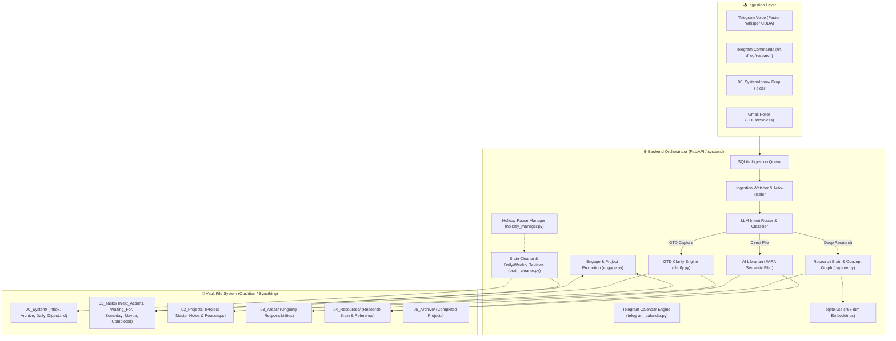

# 🛠️ Second Brain: Technical Implementation

This document details the backend architecture, data models, state machines, and system integrations for the **GTD + P.A.R.A Second Brain**.

---

## 1. System Architecture Overview



---

## 2. Task Line Schema & Field Formats

Tasks across `01_Tasks/` adhere to a standardized line format:
```text
- [ ] <description> @<context> #project/<name> #<category> 📅 YYYY-MM-DD 🔔 YYYY-MM-DD (Source: [[...]])
```

| Field | Format | Purpose & Behavior | Required? |
| :--- | :--- | :--- | :--- |
| **Status Checkbox** | `- [ ]` / `- [x]` | Completed items marked with `- [x] ~~text~~ (Completed on YYYY-MM-DD)`. | Yes |
| **Description** | `<text>` | Clean, action-oriented task summary. | Yes |
| **`@<context>`** | `@home`, `@computer`, `@errands`, `@phone`, `@anywhere`, `@office`, `@WFH` | Context execution filter used in `/next @context` and Daily Review. | Next Actions |
| **`#project/<name>`** | `#project/Project_Name` | Links task to master project note in `02_Projects/`. | Optional |
| **`#<category>`** | `#personal`, `#professional` | Scope tag used for holiday pausing and weekend filtering. | Optional |
| **`#waiting(Name)`** | `#waiting(Steven)` | Owner tracking for delegated tasks in `Waiting_For.md`. | Waiting For |
| **`📅 YYYY-MM-DD`** | `📅 2026-08-23` | Hard deadline / scheduled date (triggers <=14d alerts). | Optional |
| **`🔔 YYYY-MM-DD`** | `🔔 2026-08-20` | Tickler date (item hidden until this date, surfaces on `/daily`). | Optional |
| **`Source Link`** | `(Source: [[00_System/Inbox/Archive/file.md]])` | Traceability backlink to original capture. | Auto-generated |

---

## 3. Project Master Note Specification (`02_Projects/`)

All projects are documented using a standardized YAML and section structure:

```markdown
---
title: "Project Title"
type: project
category: Personal # Personal | Professional
outcome: "Clear definition of done"
due_date: "2026-08-23" # Optional YYYY-MM-DD or DD-MM-YYYY
date_created: "2026-08-08"
status: active # active | completed | on-hold
---
# Project Title

## Desired Outcome
Detailed statement of the desired end-state.

## Project Steps
- [ ] Future roadmap step 1
- [ ] Future roadmap step 2

## Active Actions
> View via Telegram: `/project Project_Title` or search `#project/Project_Title` in Obsidian.

```dataview
TASK
FROM "01_Tasks"
WHERE contains(tags, "#project/Project_Title") AND !completed
```

## Reference Material
- [[Linked Note 1]]
```

---

## 4. Backend Subsystems & Module Breakdown

### 4.1 Ingestion Watcher & Router (`watcher.py`)
- Background polling loop monitoring the SQLite ingestion queue and `00_System/Inbox/`.
- **Deterministic Slash Override:** Commands like `/research`, `#research`, or `/file` bypass generic classifier heuristics to route directly to their target pipelines.
- **Auto-Healer:** Detects and resolves Syncthing sync conflicts (`*.sync-conflict-*.md` and device suffixes like `-OROPVGA.md`) by performing line-level merges and committing the result to Git.

### 4.2 Clarify State Machine (`clarify.py`)
- Manages interactive multi-stage triage sessions over Telegram callback queries.
- **8-Option GTD Triage:** Next Action, Project Roadmap, New Project, Waiting For, Someday/Maybe, AI Librarian, 2-Min Rule, Trash.
- **Dynamic Project Picker:** Scans `02_Projects/Personal` and `02_Projects/Professional` to render 2-column inline buttons for rapid project association.
- **Batch Processing:** Processes 5 items per run with inline `[▶️ Continue]` / `[⏸️ Pause]` controls.

### 4.3 Telegram Inline Calendar Engine (`telegram_calendar.py`)
- Generates dynamic visual keyboard calendars for natural date selection.
- Features month navigation (`◀ August 2026 ▶`), day-of-week headers, and day buttons.
- Standardizes output dates into ISO format (`YYYY-MM-DD`) across `/clarify` deferrals, `/tickle`, and `/holiday`.

### 4.4 Engage & Step Auto-Promotion Engine (`engage.py` & `tasks_dashboard.py`)
- Powers `/next`, `/waiting`, `/project`, `/done`, `/daily`, `/status`, and `/reflect`.
- **Dual-Trigger Step Auto-Promotion:** When an action with `#project/<tag>` is completed via Telegram `/done` OR checked off `- [x]` in Obsidian:
  1. Locates the project note in `02_Projects/`.
  2. Extracts unchecked roadmap steps from `## Project Steps`.
  3. Sends an interactive Telegram prompt with candidate step buttons.
  4. Upon context selection, appends `- [ ] <step> @<context> #project/<tag>` to `Next_Actions.md` and deletes the line from `## Project Steps`.

### 4.5 Holiday Pause Manager (`holiday_manager.py`)
- Allows pausing automated review briefings while away.
- Persists holiday state (`holiday_active`, `return_date`, `scope`) across restarts.
- Scopes supported: `Personal`, `Professional`, `All`.
- Automatically suppresses daily digests and weekly reviews during active holiday windows.

### 4.6 Deep Research & Concept Knowledge Graph (`capture.py` & `brain_node.py`)
- Triggered deterministically via `/research <URL>` or academic document ingestion.
- Uses Gemini with **Context Caching** (`google-genai` SDK) to extract dense summaries and 5–15 atomic concepts.
- **Concept Updater Loop:** Atomically updates or creates bidirectional concept notes in `04_Resources/Research_Brain/Concepts/` with rate-limiting throttling.

### 4.7 Review & Maintenance Engine (`brain_cleaner.py`)
- **Daily Review (`/daily` & 07:30 run):** Gathers upcoming project deadlines (<= 14 days), surfaced ticklers (`🔔 == today`), active Next Actions grouped by `@context`, and pending Waiting items.
- **Weekly Review (`/reflect` & Friday 07:30 run):** Performs deep audit of Someday/Maybe ideas, orphaned projects (0 active next actions), stale waitings (>5 days), completed tasks, and AI research synthesis.

---

## 5. Systemd Service Management

The system operates as a persistent user service:

```ini
# ~/.config/systemd/user/second-brain.service
[Unit]
Description=Second Brain Orchestrator Daemon (GTD + PARA)
After=network.target

[Service]
Type=simple
WorkingDirectory=/home/sdmeers/second_brain
ExecStart=/home/sdmeers/second_brain/backend/.venv/bin/python3 -m backend.main
Restart=always
RestartSec=5

[Install]
WantedBy=default.target
```
